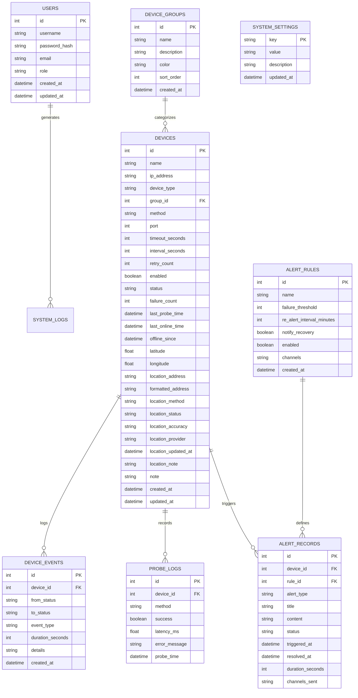
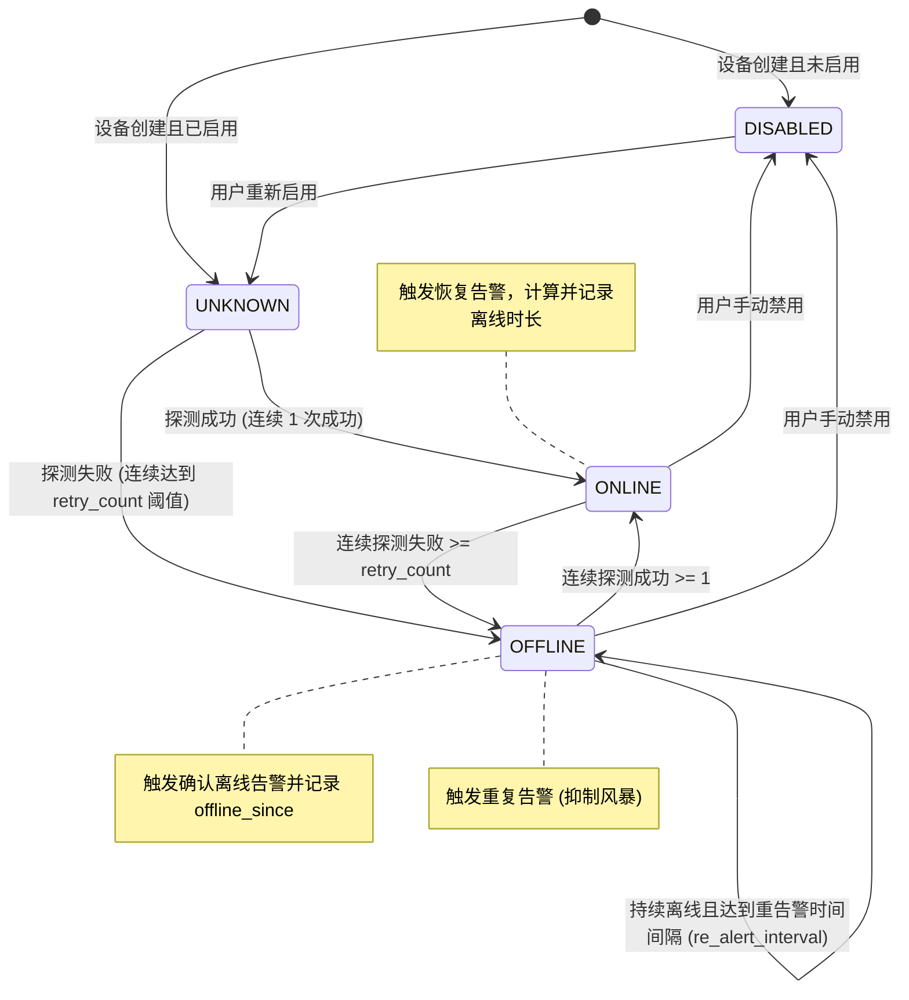

# IPMonitor Web 需求规格与架构设计说明书

**文档编号：** `docs/02-requirements-and-architecture.md`  
**版本：** v1.0.0  
**日期：** 2026-10-27

---

## 1. 总体架构拓扑

```mermaid
graph TD
    subgraph Client [前端展示层 (B/S)]
        UI_Dash[监控大屏 Dashboard]
        UI_Map[设备地图与双模式选点]
        UI_Dev[设备与分组后台管理]
        UI_Alert[告警中心与通知设置]
        UI_Hist[历史事件与报表中心]
    end

    subgraph Server [后端应用层 (FastAPI Monolith)]
        API[RESTful API 路由层]
        Auth[安全认证与会话中间件]
        Engine[独立监控调度引擎 (Background Daemon)]
        AlertHub[告警风暴抑制与通知分发器]
        ImportExport[Excel 预检导入与导出服务]
        GeoService[地理编码与坐标转换服务]
    end

    subgraph Data [数据持久层 (SQLite + WAL)]
        DB[(IPMonitor SQLite 数据库)]
        ConfigMig[旧版 config.json 平滑迁移器]
        Backup[在线备份与恢复引擎]
    end

    subgraph External [外部网络与探针通道]
        Probe_ICMP[ICMP Ping 探针]
        Probe_TCP[TCP 端口连通性探针]
        Probe_ARP[ARP 局域网探针]
        Notifier[企业微信 / 钉钉 / 飞书 / SMTP]
        MapTiles[地图瓦片与地理编码服务]
    end

    Client -->|HTTP / JSON API| API
    API --> Auth
    API --> Data
    Engine -->|读写设备状态与事件| DB
    Engine --> Probe_ICMP
    Engine --> Probe_TCP
    Engine --> Probe_ARP
    Engine --> AlertHub
    AlertHub --> Notifier
    ImportExport --> DB
    GeoService --> MapTiles
    ConfigMig -.->|首启自动转换| DB
```

---

## 2. 数据库 E-R 关系与数据表定义

系统使用 SQLite 3，开启 WAL (Write-Ahead Logging) 模式与外键约束 `PRAGMA foreign_keys = ON;`。



---

## 3. 监控引擎核心状态机



---

## 4. 设备地图与双模式定位业务规范

### 4.1 双模式定位规则
1. **地址搜索定位 (address_search)**：
   - 用户输入地址文本，由后端地理编码代理接口检索候选列表（包括名称、标准化地址、经纬度）。
   - 用户明确选定候选项后，地图移动到对应坐标并显示临时标记；用户点击“确认使用该位置”后，标记更新，`location_method` 记为 `address_search`。
2. **手动地图选点 (manual_pin)**：
   - 用户可直接在地图任意点单击放置标记，或拖拽已存在的标记微调坐标。
   - 拖拽或单击后即时回显精确经纬度，`location_method` 记为 `manual_pin`。
3. **坐标系规范**：
   - 系统内部标准存储统一为 **WGS-84**（全球通用 GPS / OSM 标准坐标系）。
   - 国内地图/地理编码服务（如高德/百度）输入输出若为 GCJ-02 或 BD-09，由后端统一算法模块无损转换，并保留原坐标系标识备查。
4. **定位一致性约束**：
   - 经纬度 `latitude` 与 `longitude` 必须 **同时有值** 或 **同时为空**。
   - 纬度合法区间：`[-90.0, 90.0]`；经度合法区间：`[-180.0, 180.0]`。
   - `location_status` 严格遵循：经纬度有效时为 `located`，否则为 `unlocated`。
   - 未定位设备具备清晰的列表标识与一键补全入口，其网络监控状态与告警正常运行，不受定位缺失影响。

---

## 5. 核心 API 规范设计

所有 API 返回统一的 JSON 包装模型：

```json
{
  "code": 200,
  "message": "success",
  "data": { ... }
}
```

| 模块 | 方法 | 路径 | 描述 |
|---|---|---|---|
| **认证** | POST | `/api/v1/auth/login` | 账号密码登录，获取 JWT Token |
| | GET | `/api/v1/auth/me` | 获取当前用户信息 |
| | POST | `/api/v1/auth/password` | 修改当前用户密码 |
| **监控大屏** | GET | `/api/v1/dashboard/stats` | 获取大屏汇总指标（设备数、在线率、活动告警等） |
| | GET | `/api/v1/dashboard/recent-events` | 最近状态变更事件列表 |
| | GET | `/api/v1/dashboard/fault-trend` | 近期故障趋势时序图表数据 |
| **设备管理** | GET | `/api/v1/devices` | 分页、分组、类型、状态查询设备列表 |
| | POST | `/api/v1/devices` | 新增监控设备（支持坐标与地址） |
| | GET | `/api/v1/devices/{id}` | 获取设备详情、历史在线率与事件 |
| | PUT | `/api/v1/devices/{id}` | 更新设备信息与位置 |
| | DELETE | `/api/v1/devices/{id}` | 删除指定设备 |
| | POST | `/api/v1/devices/{id}/probe` | 立即手动发起单次探测 |
| **设备分组** | GET | `/api/v1/groups` | 获取设备分组列表及设备数统计 |
| | POST | `/api/v1/groups` | 创建新分组 |
| | PUT | `/api/v1/groups/{id}` | 编辑分组信息 |
| | DELETE | `/api/v1/groups/{id}` | 删除分组（受引用保护检查） |
| **地图定位** | GET | `/api/v1/map/devices` | 获取包含已定位坐标的设备点位集合及未定位设备数 |
| | GET | `/api/v1/map/geocode` | 地址搜索地理编码（返回候选地址与坐标） |
| | GET | `/api/v1/map/reverse-geocode` | 坐标逆地理编码反查地址 |
| **告警通知** | GET | `/api/v1/alerts` | 分页查询告警历史与活动告警 |
| | POST | `/api/v1/alerts/{id}/resolve` | 手动标记确认告警已恢复 |
| | GET | `/api/v1/notifications/config` | 获取通知渠道配置 |
| | PUT | `/api/v1/notifications/config` | 保存通知渠道配置 |
| | POST | `/api/v1/notifications/test` | 发送指定渠道测试通知并验证真实连通性 |
| **Excel与报表** | GET | `/api/v1/excel/template` | 下载标准 3-sheet Excel 导入模板 |
| | POST | `/api/v1/excel/precheck` | Excel 导入文件格式与数据预检 |
| | POST | `/api/v1/excel/import` | 确认执行导入（按预检结果新增或覆盖） |
| | GET | `/api/v1/excel/export` | 导出设备清单与台账（Excel/CSV） |
| | GET | `/api/v1/reports/uptime` | 在线率与可用度报表统计数据导出 |
| **系统与运维** | GET | `/api/v1/system/settings` | 获取系统设置 |
| | PUT | `/api/v1/system/settings` | 更新系统设置 |
| | POST | `/api/v1/system/backup` | 触发 SQLite 在线完整备份 |
| | GET | `/api/v1/system/backups` | 备份文件列表与恢复指引 |
