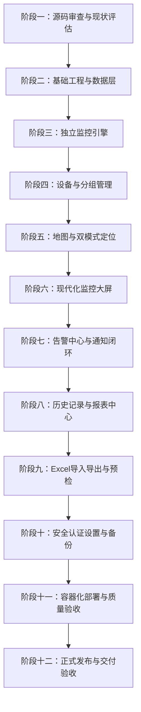

# IPMonitor Web 实施路线图与阶段推进计划

**文档编号：** `docs/03-implementation-roadmap.md`  
**版本：** v1.0.0  
**日期：** 2026-10-27

---

## 1. 阶段推进总览

根据任务书规划，整个系统升级分为十二个严密关联的阶段。各阶段相互衔接，每阶段均设置代码、测试与验证门禁：

---

## 2. 阶段详细任务与产出矩阵

### 阶段一：源码审查与项目现状评估 (当前阶段)
- **核心任务**：检查仓库工作区、技术栈、依赖项、梳理既有代码与业务逻辑，输出三份基础评估与架构文档。
- **交付物**：
  - `docs/01-project-assessment.md`
  - `docs/02-requirements-and-architecture.md`
  - `docs/03-implementation-roadmap.md`
- **验证手段**：运行既有 `test_self_check.py` 确保基线功能正常。

### 阶段二：基础工程和数据层
- **核心任务**：
  - 搭建 FastAPI 后端服务骨架（`backend/`）。
  - 安装并配置 SQLAlchemy 2.0、Pydantic v2、Alembic。
  - 实现统一 API 响应包装、全局异常拦截中间件、结构化日志。
  - 定义数据库模型（User, DeviceGroup, Device, DeviceEvent, ProbeLog, AlertRule, AlertRecord, SystemSetting）。
  - 编写旧版 `config.json` 自动平滑导入与迁移脚本。
- **交付物**：`backend/app/` 核心服务层代码、SQLite 迁移初始化脚本、配置适配器。
- **测试验证**：数据模型 CRUD 单元测试、既有配置平滑迁移测试。

### 阶段三：独立监控引擎
- **核心任务**：
  - 提取并重构 `main.py` 中的网络探针（ICMP Ping、TCP Socket、ARP 探测），封装统一 `BaseProbe` 接口。
  - 实现基于后台任务守护线程的调度器 `MonitorEngine`，与 Web 前端完全解耦。
  - 实现状态机（`ONLINE`, `OFFLINE`, `UNKNOWN`, `DISABLED`）判定与连续失败阈值计算。
  - 记录状态变动事件到 `device_events` 与详细日志到 `probe_logs`。
- **交付物**：`backend/app/engine/` 监控探活调度器模块。
- **测试验证**：模拟离线与恢复探测测试、连续失败阈值断言、状态事件写入验证。

### 阶段四：设备管理
- **核心任务**：
  - 实现设备增删改查 RESTful API，支持分页、类型、分组及关键字搜索。
  - 实现设备分组 CRUD 接口，并加入删除分组时的设备关联保护检查。
  - 实现设备级监控策略自定义（覆盖全局超时、重试与轮询周期）。
  - 提供单设备即时手动探测接口 `/api/v1/devices/{id}/probe`。
- **交付物**：`backend/app/api/v1/devices.py`、`backend/app/api/v1/groups.py`。
- **测试验证**：设备 CRUD 自动化 API 测试、分组关联保护测试。

### 阶段五：地图与位置管理
- **核心任务**：
  - 完善设备位置字段校验（经纬度联动、合法区间、位置来源 `location_method`、定位状态 `location_status`）。
  - 实现地理编码代理服务（支持候选地址搜索与逆地理编码反查）。
  - 实现 WGS-84 / GCJ-02 坐标无损转换算法。
  - 前端开发 Leaflet 地图组件，支持标记聚合、状态染色、单击放置标记与拖拽微调（manual_pin）。
  - 实现未定位设备统计与抽屉式位置快速补齐。
- **交付物**：`backend/app/services/geo.py`、前端地图与选点组件。
- **测试验证**：坐标合法性断言测试、坐标系转换测试、未定位设备列表过滤测试。

### 阶段六：监控大屏
- **核心任务**：
  - 前端搭建现代化深色/浅色仪表板（参考现代监控面板设计）。
  - 实现总体概览统计卡片（总设备数、在线、离线、未知、已禁用、在线率、活动告警）。
  - 嵌入设备状态分布图、故障趋势时序折线图（ECharts）。
  - 嵌入集成式设备小地图与设备卡片/列表视图联动。
  - 支持按分组/类型过滤与点击统计卡片快捷筛选。
- **交付物**：前端大屏页面 `frontend/src/views/Dashboard/`。
- **测试验证**：大屏数据与后端数据库统计一致性验证、筛选联动测试。

### 阶段七：告警与通知
- **核心任务**：
  - 提取重构 Webhook（企业微信、钉钉、飞书）和 SMTP 邮件推送驱动。
  - 实现告警规则配置、活动告警激活、持续离线重复告警（抑制风暴）与恢复事件闭环。
  - 引入微批次汇聚机制与免打扰时段判断。
  - 提供通知渠道一键“发送测试通知”接口并真实返回发送状态。
- **交付物**：`backend/app/services/notifier/`、告警中心界面。
- **测试验证**：告警触发与恢复闭环测试、风暴汇聚测试、免打扰算法测试。

### 阶段八：历史记录与报表
- **核心任务**：
  - 实现历史状态变更、故障事件与探针明细多维度检索（支持时间范围筛选）。
  - 实现设备可用度与在线率计算模型。
  - 实现历史报表 Excel 与 CSV 动态导出服务。
- **交付物**：`backend/app/api/v1/reports.py`、报表中心前端视图。
- **测试验证**：在线率统计公式验证、导出 Excel/CSV 内容正确性测试。

### 阶段九：Excel 导入导出
- **核心任务**：
  - 真实生成标准导入模板：`docs/templates/IPMonitor设备导入模板.xlsx`（包含设备导入、填写说明、数据字典 3 个工作表）。
  - 实现文件上传预检接口：验证必填字段、IP 格式、经纬度规范、坐标系与分组存在性，输出错误行清单。
  - 实现导入执行逻辑：支持“仅新增”、“唯一 IP 覆盖更新”与“冲突跳过”，保护未填写的已有坐标不被空白覆盖。
- **交付物**：Excel 模板文件、预检导入模块。
- **测试验证**：模板生成验证、非法数据拦截测试、空白坐标防覆盖测试。

### 阶段十：安全、设置与备份
- **核心任务**：
  - 实现本地管理员账号认证体系（密码 bcrypt 哈希存储、JWT 鉴权）。
  - 集中系统全局设置管理。
  - 实现 SQLite 在线安全热备份（基于 SQLite Online Backup API）与恢复指引。
  - 安全审查：SQL 注入、XSS、SSRF（外链与地理编码请求白名单校验）、Excel 公式注入拦截。
- **交付物**：认证鉴权模块、备份服务、安全说明文档。
- **测试验证**：未授权拦截测试、密码修改测试、备份恢复可重复性验证。

### 阶段十一：部署与质量验收
- **核心任务**：
  - 编写多阶段构建 `Dockerfile`（前端静态文件打包并由 FastAPI / Nginx 统一托管）。
  - 编写 `compose.yaml` 及 `.env.example`。
  - 编写自动化全套测试套件（pytest）。
  - 验证容器构建、启动、持久化卷读写、健康检查与服务重启数据恢复。
- **交付物**：容器化部署包、全套测试报告 `docs/test-reports/`。
- **测试验证**：Docker 镜像构建与真实容器启动测试、全量自动化测试套件执行。

### 阶段十二：正式发布与交付验收
- **核心任务**：
  - 更新根目录 `README.md` 与 `CHANGELOG.md`。
  - 完善安装、配置、操作及排障手册。
  - 整理完整的最终交付验收清单。
- **交付物**：最终代码库、文档库、交付确认书。
